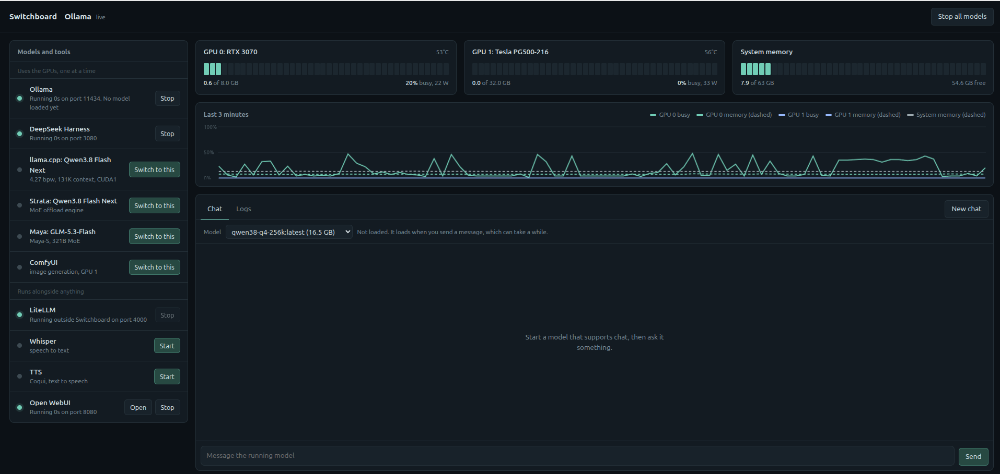

# Switchboard

A small local web app for switching between local model backends (Ollama, llama.cpp, Strata, Maya, ComfyUI and others) one at a time, watching GPU and memory use, and chatting with whatever is running.

Standard library only (Python 3). No packages to install.

## Run

    python3 switchboard.py

Then open http://127.0.0.1:8090.

Options: `--config PATH` (default `backends.json`), `--host`, `--port`.

## Features

- Start, stop and switch backends. Backends in the `gpu` group run one at a time; starting one stops the others.
- Live GPU and system memory gauges and a 3-minute history chart.
- Chat with the running backend. For Ollama, pick any installed model from a dropdown, see which one is loaded (size, context, GPU/CPU split), and unload it to free memory.
- Per-backend logs.
- An **Updates** button in the header, next to "Stop all models". A badge shows how many backends have an update available. The panel lists each backend with its status, when it was last checked, a per-row **Update** button, **Check again**, and **Update all**. Nothing is ever updated without a click: Switchboard checks at startup (read-only, one backend at a time, in the background) and when you press "Check again", but it only applies an update when you press an Update button.

## Configure

Edit `backends.json`. Each entry has an `id`, `name`, `group`, and a `kind` of `systemd`, `docker` or `process`. Entries with a `health` URL are probed to decide whether they are up; entries with an `openai_base` URL can be chatted with. The paths in the included file are examples from the author's machine; change them to match yours.

### Updates

Add an optional `update` object to any backend in `backends.json`. Backends without one do not appear in the Updates panel. Checks are read-only for the running software (`git fetch` and `docker pull` only download). Each check has a 60 second limit and shows "check timed out" if it hangs.

Any update object may set `"check_timeout": <seconds>`, the most one check (all of its commands together) may take. The default is 60 for `git`, `pip` and `github_release`, and 1800 for `docker`. A check that runs out reports "error: check timed out after N seconds. Raise check_timeout in backends.json."

Kinds:

- `{"kind": "git", "path": "/dir", "branch": "optional"}`. Check: `git fetch`, then count commits behind the upstream. A folder that is not a git checkout shows "no update source". Optional keys: `python` (a venv's python; if the repo has a `requirements.txt` it is installed with it), `post_command` (runs after a successful pull, in `post_cwd` or the repo; `post_shell: true` for pipes), `verify_command` (must exit 0 after the update).
- `{"kind": "pip", "python": "/path/to/python", "package": "name"}`. Check: `pip list --outdated` (falls back to `pip index versions`). The checked-in file uses `"python": "python3"` for LiteLLM, but the system Python on Debian and Ubuntu refuses `pip install` (PEP 668), so set `"python"` to the virtualenv's python (for example `/home/james/litellm/venv/bin/python`) before you try to update it.
- `{"kind": "github_release", "repo": "owner/name", "version_command": "ollama --version", "apply_command": "...", "shell": false}`. Check: the first version number in the command output against the latest release tag on GitHub. Entries with `use_pkexec` run the apply command through `pkexec`. The checked-in Ollama entry looks like this:

      "update": {"kind": "github_release", "repo": "ollama/ollama", "version_command": "ollama --version",
                 "apply_command": "curl -fsSL https://ollama.com/install.sh | sh", "shell": true,
                 "update_while_running": true}
- `{"kind": "docker", "image": "repo/name:tag", "apply_command": "..."}`. Check: `docker pull` (the running container is untouched), then compare image ids. `apply_command` is the command you supply to recreate the container; without it the Update button stays disabled and says "No recreate command set in backends.json." `docker pull` downloads the whole image, so the checked-in Open WebUI entry sets `"check_at_startup": false`: it is checked only when you press Check again. While the pull runs the row shows "checking" with "Downloading the image: this can take several minutes." and the other rows keep working.

Each update is a pipeline of steps run in order, stopping at the first failure: **pull** (get the new version), **install** (make it usable), **verify** (prove it works). The panel shows progress live ("pull ok · install running"). Defaults per kind:

- git: `git pull --ff-only` (a failed pull leaves the repo unchanged), install requirements and `post_command` if set, then verify that HEAD equals the upstream (plus `verify_command` if set).
- pip: `pip install --upgrade`, then `pip show` must report at least the newest version.
- github_release: `apply_command`, then `version_command` must report at least the release version.
- docker: `docker pull`, `apply_command`, then the image id must match the downloaded image and the container (if it exists) must report it.

To override the defaults, give the update object `"steps": [{"name": "pull|install|verify", "command": "...", "cwd": "...", "shell": false, "timeout": 900, "pkexec": false}]`, or `"script": "/path/to/script.sh"` as shorthand for one install step. A verify step is always added at the end if your list does not end with one, so an update is never reported as done without a passing verify. A failed step marks the row "error" with the step name and the last 40 lines of output; if the failure came after the pull, the row can be run again once you fix the cause. Full output goes to the backend's log (for process backends).

Rules: requests never carry commands, only `backends.json` does. Only one update runs at a time. A running backend must be stopped first ("Stop X first, then update it."), unless its update object sets `"update_while_running": true`; only Ollama does, because its installer restarts the service itself. If Switchboard cannot tell whether a backend is running, it assumes it is. An update and a check never run at the same time. An update is refused if a git working tree has local changes.

Security: Switchboard only answers requests whose `Host` is `127.0.0.1`, `localhost` or `[::1]` (or the `--host` value) with its own port, refuses a foreign `Origin`, and requires the header `X-Switchboard: 1` on every POST. The page sends it for you; if you script the API with curl, add `-H 'X-Switchboard: 1'`. Binding to `--host 0.0.0.0` therefore only works when you browse to `0.0.0.0:<port>` itself.

API: `GET /api/updates`, `POST /api/updates/check`, `POST /api/updates/apply/<id>`.

## License

MIT. See [LICENSE](LICENSE).
